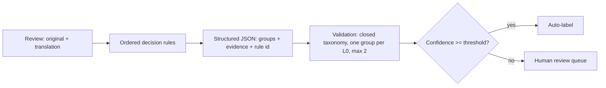

# VOC Label Agent

An evaluation-first labeling agent for multilingual customer reviews. It turns a
review into at most two structured VOC label groups, attaches a verbatim evidence
quote and the rule it used, and routes uncertain records to a human.

This is a sanitized public demo of a real workflow: 1,345 Trustpilot reviews, a
39-label taxonomy, and an owner-adjudicated evaluation set. All review text in
this repository is **synthetic**; no customer data is published.

---

## Results

Private held-out set: 50 reviews, never used in prompts or rule writing.

| System | Exact set match | L1 micro-F1 |
|---|---:|---:|
| Old labels + old prompt | 54.0% | 0.691 |
| v2 labels + 6-shot prompt | 44.0% | 0.650 |
| **v3: ordered rules + adjudicated gold** | **80.0% (40/50)** | **0.886** |
| v2 predictions re-scored on the same gold | 46.0% | 0.671 |

Two honest caveats:

- A 20-case hard subset reached 100% during iteration. That was **overfitting**;
  the 50-case number is the real result. The gap is the most useful lesson here.
- The 50-case gold set is private because it contains customer text. The demo in
  this repo runs on 10 synthetic reviews and is a smoke test, not a benchmark.

---

## Pipeline



Three design choices do most of the work:

1. **Ordered, mutually exclusive rules.** Each family is a decision list —
   "first match wins" — instead of a glossary of near-synonyms. Example:
   no effective reply → no reply; replied but slow or went silent → slow;
   replied, not slow, unresolved → unresolved.
2. **One group per L0, max two groups.** The production registration rule. This
   removed the "extra plausible tag" failure mode.
3. **Evidence + rule id per group.** Every label must quote the review and name
   the rule that produced it. Unsupported groups are dropped and sent to review.

---

## Quickstart

```bash
pip install -r requirements.txt
export VOC_API_BASE="https://your-openai-compatible-endpoint/v1"
export VOC_API_KEY="..."
export VOC_MODEL="deepseek-v4.1-flash"

python scripts/run_demo.py
```

The demo labels 10 synthetic reviews with 4 synthetic examples and prints a
per-record table plus exact-set-match.

```
id | gold | prediction | ok
demo_01 | 产品问题/产品完全不能用 | 产品问题/产品完全不能用 | OK
...
```

No model call is made at import time; the package only depends on `requests` at
runtime. Python 3.9+.

---

## Design decisions

- **Read the original first.** The translation is secondary evidence. In one real
  case the translation inverted "was replying" into "was impatient"; a
  translation-only reader labeled it "no reply", while the original supported
  "slow response".
- **Rules before examples.** Adding few-shot examples without an execution order
  did not help; reducing 10 examples to 6 made it worse. Ordered rules plus
  boundary examples moved exact match from 44% to 80%.
- **Adjudicate gold before tuning prompts.** When two reviews with the same facts
  carried opposite labels, no prompt could satisfy both. The fix was an ambiguity
  workbook and owner adjudication, not more prompt text.
- **Stop at the variance floor.** Two consecutive rounds fixed N cases and broke
  N cases. Further prompt edits only moved errors around.
- **Technical failures are not judgment errors.** Empty JSON and prose responses
  are counted separately and retried with a compact schema.

---

## What I learned

The interesting part was not the model; it was finding out that the evaluation set
itself was inconsistent. Three pairs of reviews had identical evidence but
opposite gold labels. Once the owner adjudicated 18 ambiguous rows (11 labels
changed), the same prompt went from 72% to 80%, and the remaining errors became
explainable instead of random.

The second lesson: a 20-case subset can look perfect while the 50-case set says
80%. Small-set wins are directional, not conclusive.

---

## Repo layout

```
data/
  taxonomy.json          # 39 labels across 9 L0 groups (v2)
  demo_examples.jsonl    # 4 synthetic few-shot examples (dev)
  demo_reviews.jsonl     # 10 synthetic reviews (test)
scripts/
  run_demo.py            # demo runner: retries, repair, per-L0 dedupe
src/voc_label_agent/
  prompts_v3.py          # ordered rules + boundary tests + output protocol
  schema.py              # JSON extraction, validation, review routing
  eval.py                # exact-set match, micro-F1, risk-coverage
  taxonomy.py            # label space + aliases
docs/
  DECISIONS.md           # the 78% -> 66% -> 80% iteration story
  RESULTS.md             # tables and residual error analysis
tests/                   # unit tests, no model calls
```

---

## Limitations

- Prompt-only; no fine-tuning. Single model family.
- 10 synthetic demo reviews cannot validate accuracy.
- The private 50-case result has a wide confidence interval: 40/50 is 80% ± 11
  points at 95% confidence. Treat it as a direction, not a precise score.
- Label boundaries are business conventions. Another team would adjudicate them
  differently.

## Privacy

No real reviews, order IDs, emails, or phone numbers are included. The demo data
was written for this repository. The production dataset stays local and is
never published.
