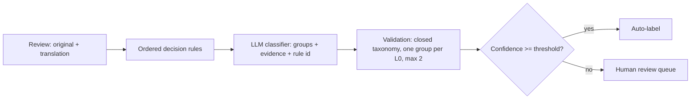

# VOC Labeling Pipeline (eval-first)

A small evaluation-first pipeline for multilingual customer reviews: an LLM
classifier, ordered decision rules, deterministic validation, and a human review
queue.

**What it is not:** an autonomous agent. There are no tool calls, no planning
loop, and no memory. "LLM classifier + validation + review routing" is the
accurate description; agentic orchestration is future work.

This is a sanitized public snapshot of a real workflow. All review text in this
repository is **synthetic**; no customer data is published.

---

## What this is / is not

| Is | Is not |
|---|---|
| An LLM classifier with a closed label space | An autonomous agent |
| Ordered, testable decision rules | A fine-tuned model |
| Deterministic validation + review routing | A production service |
| An evaluation harness with a label-only export | An independently auditable benchmark |

---

## Results (internal, label-only)

Private held-out set: 50 reviews, never used in prompts or rule writing.

| System | Exact set match | L1 micro-F1 |
|---|---:|---:|
| Old labels + old prompt | 54.0% | 0.691 |
| v2 labels + 6-shot prompt | 44.0% | 0.650 |
| **v3: ordered rules + adjudicated gold** | **80.0% (40/50)** | **0.886** |
| v2 predictions re-scored on the same gold | 46.0% | 0.671 |

95% Wilson interval for 40/50: **67–89%**. A four-case difference between runs
is noise; do not read 72% vs 80% as a real improvement.

The review text cannot be published. To make the count checkable anyway,
`results/test50_labels.csv` exports **label pairs only** (no customer text), and
`scripts/verify_results.py` recomputes the number:

```
rows: 50
exact match: 40/50 = 80.0%
inconsistent flags: 0
```

That verifies the arithmetic, not whether the gold labels are correct. The
latter needs the private text and a human reader.

---

## Reproducible without an API key

```
pip install -r requirements.txt
python scripts/run_demo.py --score-only   # 10 synthetic reviews, cached predictions
python scripts/verify_results.py          # recompute the label-only 40/50
```

A live run (new predictions) needs an OpenAI-compatible endpoint:

```
export VOC_API_BASE="https://your-endpoint/v1"
export VOC_API_KEY="***"
export VOC_MODEL="deepseek-v4.1-flash"
python scripts/run_demo.py
```

The demo is a smoke test, not a benchmark. It uses 10 synthetic reviews written
to exercise the rules; 10/10 there says the pipeline runs, not that it is 100%
accurate.

---

## Pipeline



Three design choices do most of the work:

1. **Ordered, mutually exclusive rules.** Each family is a decision list —
   "first match wins" — instead of a glossary of near-synonyms.
2. **One group per L0, max two groups.** The production registration rule.
3. **Evidence + rule id per group.** Every label must quote the review and name
   the rule that produced it.

---

## Evidence and limits

What you can check in this repository:

- the label arithmetic: 40/50 via `scripts/verify_results.py`;
- the offline demo: 10/10 via `run_demo.py --score-only`, no API key;
- the unit tests: 13 tests, plus the CI workflow;
- the decision record: `docs/DECISIONS.md` and `docs/ITERATION_LOG.md`.

What you cannot check:

- whether the 50 gold labels are correct (private text);
- whether the model would reproduce the same labels on a new day (no fixed seed
  at the provider level);
- real-world accuracy: 50 hard cases with a wide interval.

**Repository history:** this is a snapshot published on 2026-11-24. The iteration
happened locally on 2026-11-23/24 and was not preserved as per-round commits.
History was not rewritten to fake a narrative; `docs/ITERATION_LOG.md` is the
record of what changed and in which order.

---

## Design decisions

- **Read the original first.** The translation is secondary evidence.
- **Rules before examples.** Few-shot examples without an execution order did not
  help; ordered rules plus boundary examples moved exact match from 44% to 80%.
- **Adjudicate gold before tuning prompts.** Two reviews with the same facts had
  opposite labels; no prompt can satisfy both.
- **Stop at the variance floor.** Two rounds fixed N cases and broke N cases.
- **Technical failures are not judgment errors.** Empty JSON and prose responses
  are counted separately and retried with a compact schema.

---

## Repo layout

```
data/
  taxonomy.json           # 39 labels across 9 L0 groups
  demo_examples.jsonl     # 4 synthetic few-shot examples (dev)
  demo_reviews.jsonl      # 10 synthetic reviews (test)
  demo_predictions.jsonl  # cached predictions for offline scoring
results/
  test50_labels.csv       # label pairs only, no review text
  test50_metrics.json     # 40/50, 95% Wilson interval
scripts/
  run_demo.py             # live run or --score-only
  verify_results.py       # recompute 40/50 from labels
src/voc_label_agent/
  prompts_v3.py           # ordered rules + boundary tests + output protocol
  schema.py               # JSON extraction, validation, review routing
  eval.py                 # exact-set match, micro-F1, risk-coverage
  taxonomy.py             # label space + aliases
docs/
  DECISIONS.md            # the 78% -> 66% -> 80% iteration story
  ITERATION_LOG.md        # dated record of the local iterations
  RESULTS.md              # tables and residual error analysis
tests/                    # 13 unit tests, no model calls
```

---

## Limitations

- Prompt-only; no fine-tuning. Single model family.
- 50-case internal set; 95% interval roughly 67–89%.
- The 10 synthetic demo reviews are a smoke test, not accuracy evidence.
- Label boundaries are business conventions; another team would adjudicate them
  differently.
- The pipeline is a classifier plus routing, not an agent.

## Privacy

No real reviews, order IDs, emails, or phone numbers are included. The demo data
was written for this repository. The production dataset stays local and is never
published.
